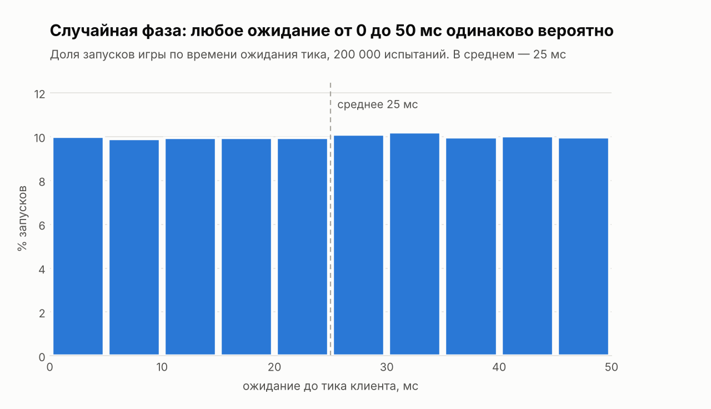
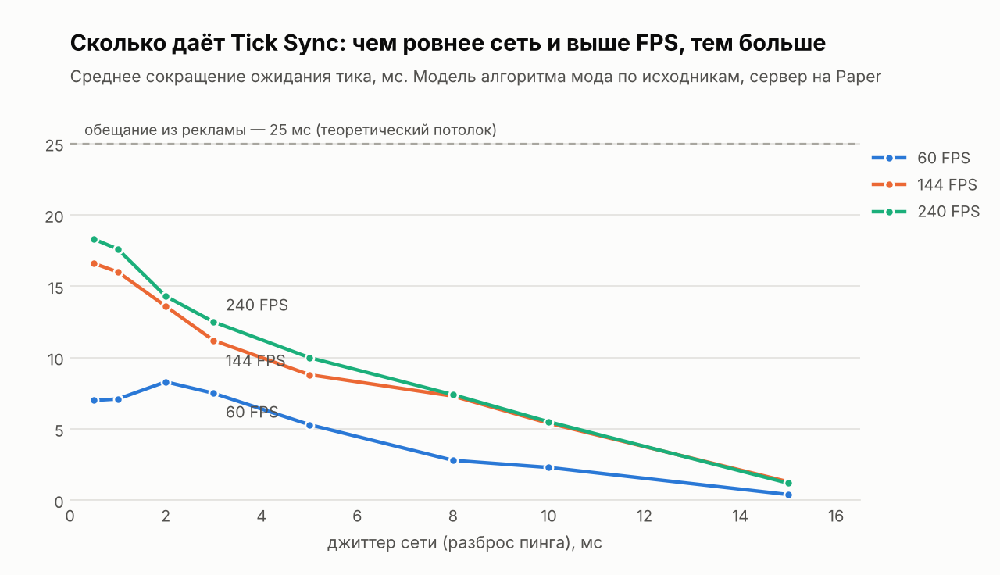
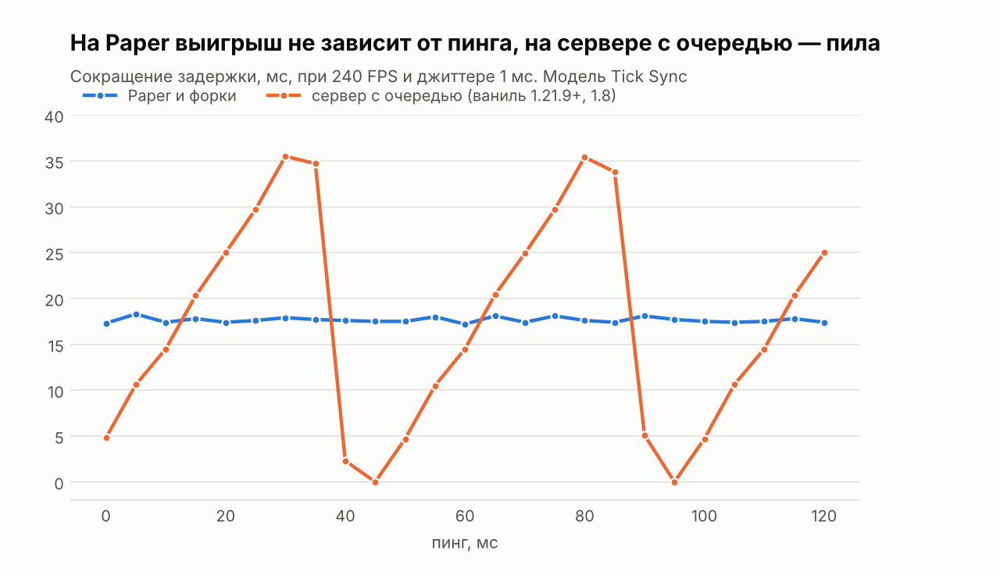
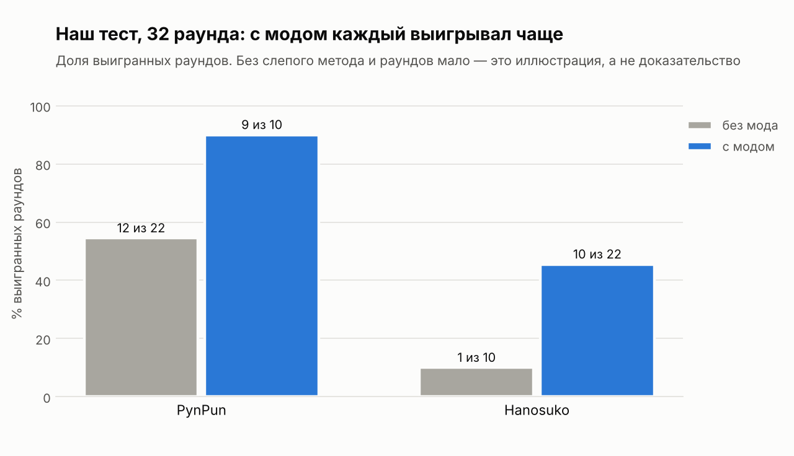

# Фаза тиков в Minecraft: скрытая задержка, которой нет в табе

При одинаковом пинге 2 мс один игрок может видеть соперника с опозданием 44 мс, а другой — 6 мс. Разницу даёт **фаза тиков** — сдвиг между тиками сервера и тиками вашего клиента. В табе её не видно, но она влияет на размены, отбрасывание (КБ) и тот самый «рич 3,2».

В этом репозитории — модели и данные к видео-разбору:

- симуляция фазы тиков: сколько данные ждут тика, как это решает размены и сколько можно выиграть выравниванием;
- модель мода [Tick Sync](https://modrinth.com/mod/tick-sync), повторяющая его алгоритм по исходникам, — чтобы оценка выигрыша была не «в идеале», а как у настоящего мода;
- наш тест на 32 раунда (Hanosuko против PynPun) и его статистический разбор.

> **Видео-разбор:** [смотреть на YouTube](https://www.youtube.com/watch?v=9NwSDtUSyoE)
>
> **Бои нашего теста с двух сторон:** [PvP от лица Hanosuko](https://youtu.be/-fOGpKdxE8g) · [PvP от лица PynPun](https://www.youtube.com/watch?v=50dloJN8rfE) · все записи также в [t.me/hanosuko](https://t.me/hanosuko)
>
> **Сервер, где сняты бои на пинге 2:** `cisprac.xyz`

## Коротко

- Minecraft считает мир тиками: 20 в секунду, один тик — 50 мс. Тикают и сервер, и клиент, но каждый по своим часам.
- Пришедшие данные клиент применяет только в свой тик. Ожидание — от 0 до 50 мс, в среднем 25 — зависит от фазы. В пинге его нет.
- Фаза случайная: выпадает при запуске игры и медленно плывёт, поэтому «Поток» сам приходит и сам уходит.
- Выравнивание фазы (Tick Sync) по модели даёт до **≈ 17–18 мс** при ровной сети и высоком FPS, а не 25, как обещает реклама одного PvP-клиента. На 60 FPS — примерно вдвое меньше, на скачущем Wi‑Fi — ещё меньше.
- На Paper выигрыш не зависит от величины пинга. В минус задержка не уходит: мод срезает ожидание тика, а не дорогу пакета.

## Что внутри

```
models/
  simulation.py        упрощённая модель: лотерея фазы, выигрыш от джиттера и пинга, правило размена
  ticksync_model.py    алгоритм Tick Sync по исходникам: FPS, джиттер, пинг, частота пересинхронизаций
test/
  test_raundy.csv      все 32 раунда нашего теста
  test_analysis.py     разбор: доли побед, интервалы, точный тест Фишера, сессия 4
results/               CSV с результатами (скрипты перезаписывают их при запуске)
  charts/              графики для этого README (светлая и тёмная версии)
plots.py               строит графики из results/
docs/
  METODIKA.md          как устроены модели, допущения, ссылки на строки кода
  TEST.md              как проходил тест, что он показывает и чего не показывает
```

## Как запустить

Нужен Python 3.10+.

```bash
pip install -r requirements.txt
python models/simulation.py      # ~5 секунд
python test/test_analysis.py     # ~2 секунды
python models/ticksync_model.py  # ~5 минут: честно гоняет мод кадр за кадром
python plots.py                  # графики в results/charts/
```

У всех скриптов зафиксирован seed, поэтому результаты совпадают с CSV в репозитории до последней цифры.

## Результаты

### 1. Случайная фаза — это лотерея

<picture>
  <source media="(prefers-color-scheme: dark)" srcset="results/charts/random_phase_wait_dark.png">
  
</picture>

Каждый запуск игры даёт новую фазу. Любое ожидание от 0 до 50 мс одинаково вероятно, среднее — 25 мс. Перезаход на тот же сервер фазу, скорее всего, не меняет: клиент продолжает считать тики от запуска игры.

### 2. Сколько даёт Tick Sync

<picture>
  <source media="(prefers-color-scheme: dark)" srcset="results/charts/ticksync_gain_vs_jitter_dark.png">
  
</picture>

Среднее сокращение ожидания тика, мс (`results/ticksync_model.csv`, сервер на Paper):

| Джиттер | 60 FPS | 144 FPS | 240 FPS | 360 FPS |
| --- | --- | --- | --- | --- |
| 1 мс (хороший кабель) | 7,1 | 16,0 | 17,6 | 18,2 |
| 2 мс | 8,3 | 13,6 | 14,3 | 14,6 |
| 3 мс | 7,5 | 11,2 | 12,5 | 12,9 |
| 5 мс | 5,3 | 8,8 | 10,0 | 10,8 |
| 8 мс (Wi‑Fi) | 2,8 | 7,3 | 7,4 | 7,8 |
| 10 мс | 2,3 | 5,4 | 5,5 | 5,4 |
| 15 мс | 0,4 | 1,3 | 1,2 | 0,8 |

Почему не 25: мод держит запас 6–16 мс на скачки пинга — иначе опоздавший на миллисекунду пакет пролежит почти 50. А клиентский тик случается только на границе кадра, поэтому на 60 FPS (кадр 17 мс) точность выравнивания падает.

Цена: примерно раз в 1–3 минуты один тик растягивается до 64–74 мс вместо 50, когда мод подправляет фазу (`results/ticksync_resync.csv`).

### 3. Пинг: Paper против сервера с очередью

<picture>
  <source media="(prefers-color-scheme: dark)" srcset="results/charts/gain_vs_ping_dark.png">
  
</picture>

Paper обрабатывает пакеты игроков сразу по приходу, между тиками. Ванильный сервер 1.21.9+ (и 1.8) разбирает их только в начале своего тика — это второе ожидание от 0 до 50 мс. На Paper выигрыш мода не зависит от пинга; на сервере с очередью он идёт «пилой» от 0 до 35 мс в зависимости от пинга (`results/ticksync_ping.csv`).

### 4. Размен: кто бьёт первым

Упрощённая модель сближения (`results/trade_first_hit.csv`): решает сумма «пинг + ожидание своего тика».

| Игрок А | Игрок Б | Б бьёт первым |
| --- | --- | --- |
| пинг 2 + ожидание 43 = 45 | пинг 2 + ожидание 5 = 7 | 81% разменов |
| пинг 20 + ожидание 45 = 65 | пинг 20 + ожидание 5 = 25 | 82% |
| пинг 2 + ожидание 45 = 47 | пинг 20 + ожидание 5 = 25 | 70% |
| пинг 2 + ожидание 43 = 45 | пинг 40 + ожидание 5 = 45 | 50% |
| пинг 40 + ожидание 25 = 65 | пинг 40 + ожидание 25 = 65 | 50% |

Удачная фаза работает как пинг на десятки миллисекунд ниже: игрок с пингом 20 и удачной фазой забирает 70% разменов у игрока с пингом 2 и неудачной.

### 5. Наш тест: 32 раунда

<picture>
  <source media="(prefers-color-scheme: dark)" srcset="results/charts/test_win_share_dark.png">
  
</picture>

| Сессия | Сервер | Пинг | Мод у | Счёт Hanosuko : PynPun |
| --- | --- | --- | --- | --- |
| 1 | cisprac.xyz | 0 | Hanosuko | 4 : 5 |
| 2 | cisprac.xyz | 2 | PynPun | 0 : 4 |
| 3 | sworder.xyz (Швеция) | 20 | PynPun | 1 : 5 |
| 4 | sworder.xyz (Швеция) | 20 | Hanosuko | 6 : 7 |

Бои целиком: [от лица Hanosuko](https://youtu.be/-fOGpKdxE8g) и [от лица PynPun](https://www.youtube.com/watch?v=50dloJN8rfE).

С модом доля выигранных раундов выросла у каждого на 35 процентных пунктов. Но точный тест Фишера даёт p ≈ 0,06 (односторонний), игроки знали, у кого мод, а раундов мало. **Это иллюстрация, а не доказательство.** Подробности и план слепого теста — в [docs/TEST.md](docs/TEST.md).

## Допущения и ограничения

- Все цифры о выигрыше — **оценка по моделям, а не замер в игре**. Пример «44 мс против 6 мс» — иллюстрация.
- Модели упрощены: сервер не лагает, пинг симметричный, джиттер нормальный, пакеты приходят по порядку. Полный список — в [docs/METODIKA.md](docs/METODIKA.md).
- `ticksync_model.py` повторяет логику Tick Sync по чтению его исходников (коммит `d0ae181`) для анализа. Код самого мода в репозиторий не входит: у Tick Sync лицензия ARR, все права у автора.

## Источники

| Источник | Что подтверждает |
| --- | --- |
| [Minecraft Wiki — Tick](https://minecraft.wiki/w/Tick) | 20 тиков в секунду, тик = 50 мс |
| [Tick Sync — Modrinth](https://modrinth.com/mod/tick-sync) | клиент ждёт конца тика, прежде чем применить пакет; мод сдвигает тики на клиенте |
| [Tick Sync — TickSyncMain.java](https://github.com/LogGamja/tick-sync-1.21.5/blob/d0ae18162a696af8fedccb041228ddc09b539a0d/src/main/java/loggamja/sync/TickSyncMain.java#L259-L295) | расчёт сдвига и растягивание тика |
| [Paper 1.21.11 — патч PacketProcessor](https://github.com/PaperMC/Paper/blob/c5eb0790f199da6c38d0a650e1e5cd5415b28185/paper-server/patches/sources/net/minecraft/network/PacketProcessor.java.patch#L31-L43) | Paper будит сервер на каждый пакет между тиками |
| [Paper 1.21.11 — патч MinecraftServer](https://github.com/PaperMC/Paper/blob/c5eb0790f199da6c38d0a650e1e5cd5415b28185/paper-server/patches/sources/net/minecraft/server/MinecraftServer.java.patch#L1012-L1015) | ваниль разбирает очередь пакетов в начале тика, Paper это меняет |
| [Moonrise](https://modrinth.com/mod/moonrise-opt) · [код](https://github.com/Tuinity/Moonrise/blob/dd225b93c6ea0af944437622c15eb45c9036cced/src/main/java/ca/spottedleaf/moonrise/mixin/tick_loop/MinecraftServerMixin.java#L460-L472) | обработка пакетов во время ожидания тика снижает задержку |
| [Better Hitreg — README](https://github.com/jasspir/BetterHitreg/blob/e0c09f819ac4ca00850b95c0d8e81127f1c743bc/README.md?plain=1#L20) | кастомные удары только для вида; команда `/hitreg alertDelays` |
| [KnockbackSync](https://github.com/Axionize/knockback-sync) | выравнивание КБ при разном пинге на стороне сервера |

## Лицензия

Код — [MIT](LICENSE). Данные теста (`test/test_raundy.csv`) — [CC BY 4.0](https://creativecommons.org/licenses/by/4.0/): можно использовать с указанием авторов (Hanosuko, PynPun).

Авторы: Hanosuko (идея, тест, видео), PynPun (тест).
